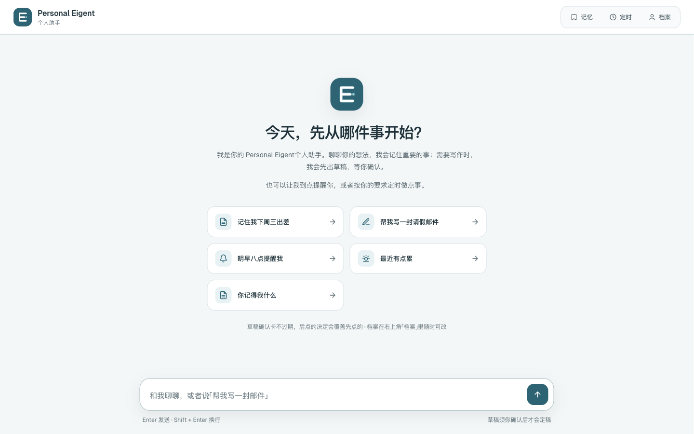
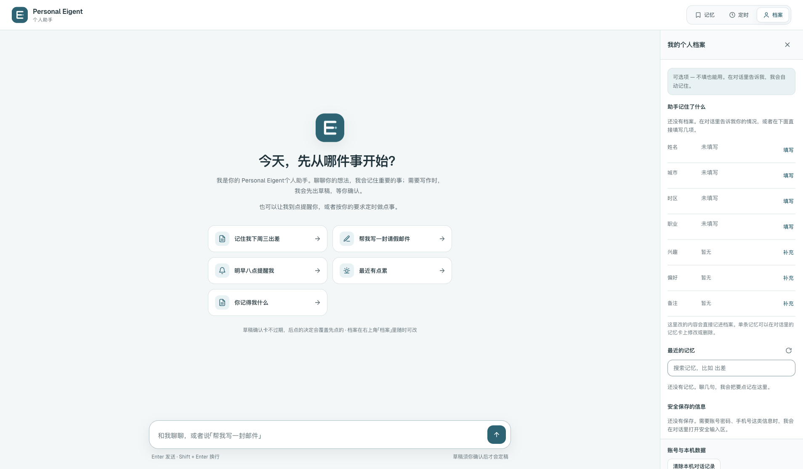

# Personal Agent

有长期记忆的个人 AI 助手。通过对话管理个人信息、起草内容、设置提醒，在执行需要确认的任务前展示确认卡。

[](LICENSE)
[](Dockerfile)
[](VERSION)

Python 3.12 · FastAPI · LangGraph · SQLite / PostgreSQL · 原生 JavaScript

## 界面预览





界面采用冷白与湖蓝配色，统一对话、个人档案、定时任务、渠道绑定、安全输入区与管理后台的视觉样式。本次更新保留现有布局，以及 Agent 编排、模型调用、记忆存储、身份校验和确认协议。

## 功能

| 能力 | 使用方式 |
|------|----------|
| 对话与长期记忆 | 在聊天中告诉助手你的职业、城市、兴趣和偏好；通过记忆卡查看、修改或遗忘记录 |
| 写作与草稿 | 起草邮件、消息、文章和笔记；确认卡支持确认、修改意见和拒绝后重写 |
| 提醒与定时任务 | 创建一次性提醒或自定义只读任务；确认后由调度器运行，结果进入应用内收件箱 |
| 公开信息查询 | 读取公开网页、RSS、搜索和 Hacker News；外部内容作为不可信数据处理 |
| 多渠道入口 | 可配置飞书长连接、微信 OpenClaw 桥接，绑定后共享档案和记忆 |
| 隐私与可观测性 | 敏感输入分流、加密保存、出站过滤、脱敏轨迹、管理员访问控制 |

可以从这些请求开始：

```text
我在上海做产品经理，最近在学习 Python，帮我记住。
帮我起草一封项目进度邮件，语气简洁一些。
明天下午三点提醒我整理会议记录。
看看你记住了哪些关于我的信息。
```

提醒、渠道和向量记忆需要单独配置并开启。没有模型 API Key 时，系统使用离线占位回复，可用于查看流程，不能据此评估真实模型的回答质量。

## 快速开始

需要 Python 3.12。前端无需安装 Node.js 或执行打包命令。

```bash
git clone https://github.com/leo-ai-pm/personal-eigent.git
cd personal-eigent
python3 -m venv .venv
source .venv/bin/activate
pip install -r requirements.txt -c requirements.lock
cp .env.example .env
```

Windows PowerShell 使用 `.venv\Scripts\Activate.ps1` 激活虚拟环境。

在 `.env` 中设置：

```dotenv
AUTH_SECRET=替换为随机生成的密钥
KIMI_API_KEY=替换为你的模型APIKey
```

`AUTH_SECRET` 必填，可用以下命令生成：

```bash
python -c "import secrets; print(secrets.token_hex(32))"
```

`KIMI_API_KEY` 可暂时留空以体验离线流程。使用其他服务商时，配置 `LLM_FAST_*`、`LLM_STRONG_*`，详见 [模型网关](docs/llm-gateway.md)。模型名称、接口地址和 Key 需要与服务商实际提供的模型对应。

启动服务：

```bash
uvicorn app.main:app --host 127.0.0.1 --port 8787
```

以下为本地启动后的页面路径，访问时使用你实际运行服务的地址和端口。

| 入口 | 路径 |
|------|------|
| 个人助手 | `/` |
| 健康检查 | `/health` |
| API 文档 | `/docs` |
| 管理后台 | `/admin`，需配置管理员令牌 |

默认数据保存在 `DATA_DIR` 指定目录（本地默认 `./data`），请保留该目录和用于签名、加密的密钥。填写过的 `.env` 不应提交到 Git。

### Docker

先按上文填写 `.env`，再运行：

```bash
docker build -t personal-eigent .
docker run --rm -p 127.0.0.1:8787:8787 --env-file .env \
  -e DATA_DIR=/app/data -v personal-eigent-data:/app/data personal-eigent
```

命名卷保存数据库等运行数据。云端可使用仓库内的 Render Blueprint，配置步骤和持久化说明见 [部署指南](docs/deploy.md)。

## 配置

完整配置说明见 [`.env.example`](.env.example)。

| 场景 | 配置项 |
|------|--------|
| 浏览器会话 | `AUTH_SECRET` |
| 真实模型对话 | `KIMI_API_KEY`，或 `LLM_FAST_BASE_URL/MODEL/API_KEY` 与 `LLM_STRONG_*` |
| 加密安全输入区 | `SECRETS_FERNET_KEY` |
| 定时任务和提醒 | `PROACTIVE_ENABLED=1`、`PROACTIVE_TZ` |
| 飞书 | `FEISHU_ENABLED=1`、`FEISHU_APP_ID`、`FEISHU_APP_SECRET`、`PUBLIC_BASE_URL` |
| 微信桥接 | `OPENCLAW_WECHAT_ENABLED=1`、`OPENCLAW_*`、`PUBLIC_BASE_URL` |
| 管理后台 | `HARNESS_ADMIN_TOKENS`，格式 `name:token[:scope]`，令牌至少 16 位 |
| 向量记忆 | `MEMORY_VECTOR_ENABLED=1`，及对应嵌入服务配置 |
| Langfuse | `LANGFUSE_ENABLED=1`，及 Host、Public Key、Secret Key |
| PostgreSQL | `DATABASE_URL`、`SYSTEM_DATABASE_URL`，并按文档执行 RLS 迁移 |

飞书、微信、主动调度、向量记忆和 Langfuse 默认关闭。渠道绑定和安全输入链接需要用户可访问的 HTTPS `PUBLIC_BASE_URL`；飞书长连接本身不需要公开 webhook。

## 身份与使用边界

- **使用浏览器会话识别用户。** 服务端签发会话 Cookie，当前没有常规的邮箱密码注册、登录或找回账号流程。换浏览器、清除 Cookie 或会话失效，不能依靠输入姓名找回原档案；界面中的“重新开始”会使用新会话。
- **草稿不会自动对外发送。** 当前没有替用户发邮件、发消息、提交外部表单、登录网站或无人值守操作的能力。
- **需要确认的动作保留确认步骤。** 草稿、定时任务等使用确认卡；页面更新不绕过身份校验和一次性确认凭证。
- **敏感信息通过专用入口处理。** 聊天中的敏感内容会触发分流；安全保存依赖 `SECRETS_FERNET_KEY`。模型仍可能出错，重要内容应自行核对。
- **QQ 接入尚未实现。** 当前仅预留渠道接口；飞书和微信需要各自的凭据及接入配置。
- **PostgreSQL 不能替代所有本地存储。** 业务数据支持 PostgreSQL 与 RLS，审计和 LangGraph checkpoint 仍使用 SQLite；部署时仍须考虑本地数据持久化。

## 技术结构

```text
app/
  main.py              HTTP 路由与静态页面入口
  graph.py             LangGraph 编排入口
  agent/               意图路由、工具、记忆、定时任务与护栏
  gateway/             模型配置、FAST / STRONG 分档与失败降级
  channels/            Web、飞书与微信渠道适配
  data_access/         数据访问与用户隔离
  prompts/             版本化提示词
static/                HTML、CSS、原生 JavaScript 与本地字体
tests/                 单元、集成与金标回归测试
docs/                  架构、接口、配置和部署说明
```

模型请求经网关选择对应档位和模型链。对话与任务由 LangGraph 路由到相应子图，调用记忆和工具；需要用户决定时返回确认卡。输出经过护栏处理，再交给网页或已绑定渠道展示。

### 主要 API

| 接口 | 用途 |
|------|------|
| `POST /api/session` | 创建或刷新浏览器会话 |
| `POST /api/chat`、`POST /api/draft` | 对话与草稿 |
| `POST /api/confirm/{thread_id}/token`、`POST /api/confirm` | 获取一次性凭证并提交确认或拒绝 |
| `POST /api/continue` | 继续达到预算限制的任务 |
| `GET /api/profile/{user_id}`、`POST /api/profile` | 读取与更新个人档案 |
| `/api/memory/{user_id}*` | 查看、编辑与遗忘记忆 |
| `/api/schedules*`、`/api/proactive/pending` | 定时任务与提醒收件箱 |
| `/api/secrets*` | 加密保存与脱敏列表 |
| `/api/channels/*`、`/webhooks/*` | 渠道绑定与消息接入 |
| `/api/admin/*` | 受管理员权限保护的轨迹、审计、反馈与用户管理 |

用户身份以服务端验证的 Cookie / Token 为准，不能通过修改请求里的 `user_id` 切换用户。详细参数以运行中的 `/docs` 和各模块文档为准。

## 开发与验证

```bash
pip install -r requirements-dev.txt -c requirements.lock
python -m pytest -q
AUTH_SECRET=x INTENT_SCORING_MODE=rules python tests/golden/run_golden.py --mode mock --judge-gate
AUTH_SECRET=x python tests/golden/run_hybrid.py --mode mock --judge-gate
python scripts/harness_golden.py
```

`pytest` 的测试配置会清除模型 API Key 并禁用 `.env` 加载，使用 mock 模式。真实模型验证需显式运行 `python scripts/live_smoke.py` 或金标脚本的 `--mode live`，并配置有效 Key；这类运行会调用模型服务。

前端修改集中在 `static/`，没有构建步骤。调整样式和布局时需保留 API 字段、会话机制、确认流程和敏感输入分流。扩展工具、渠道、记忆或编排的入口见 [开发指南](CONTRIBUTING.md)。

## 文档

| 主题 | 说明 |
|------|------|
| 架构 | [Agent 栈](docs/agent-stack.md) · [技术架构](docs/技术架构.md) |
| 模型 | [模型网关](docs/llm-gateway.md) · [多模型配置示例](docs/llm_models.example.json) |
| 工具 | [工具清单](docs/tools.md) · [注册机制](docs/tool-registry.md) |
| 记忆 | [上下文组装](docs/context-assembly.md) · [向量记忆](docs/vector-memory-write.md) |
| 渠道 | [渠道说明](docs/channels.md) · [飞书长连接](docs/feishu-长连接.md) · [微信桥接](integrations/openclaw-personal-agent-bridge/README.md) |
| 任务 | [定时任务](docs/schedules.md) |
| 运维 | [部署](docs/deploy.md) · [PostgreSQL / RLS](docs/postgres-rls.md) · [管理后台](docs/admin.md) · [Langfuse](docs/langfuse.md) |

## 许可

代码采用 [MIT 许可证](LICENSE)，随附字体的许可说明也收录于该文件。
